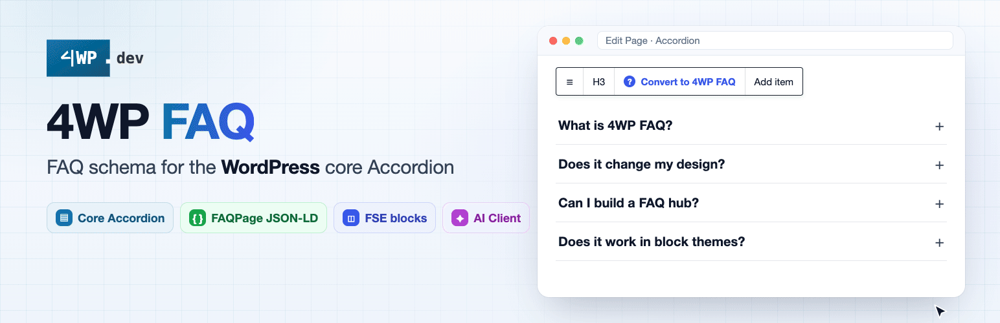
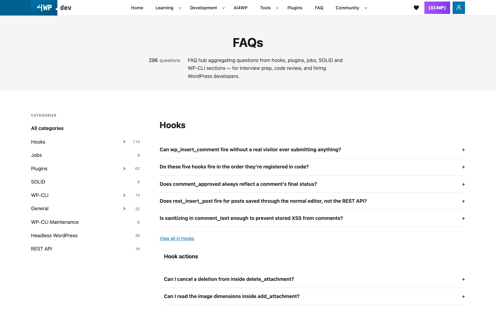
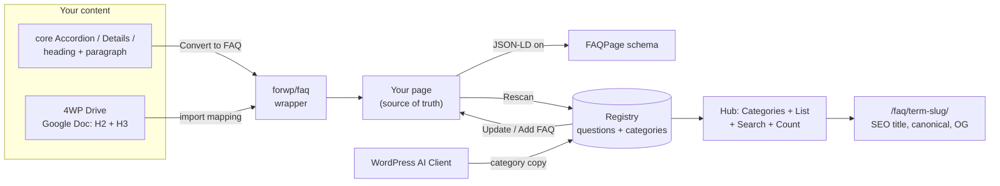

<p align="center"><a href="https://4wp.dev/plugin/4wp-faq/"></a></p>

# 4WP FAQ — FAQ schema and registry for the WordPress core Accordion

[](https://wordpress.org/plugins/4wp-faq/)
[](https://wordpress.org/plugins/4wp-faq/)
[](https://wordpress.org/plugins/4wp-faq/)
[](https://www.php.net/)
[](https://www.gnu.org/licenses/gpl-2.0.html)

**Not another FAQ block.** 4WP FAQ wraps the core **Accordion** you already use, adds **FAQPage JSON-LD**, and turns every question on your site into one registry you can reuse, update everywhere, and show as a searchable hub. Your design stays the same. Free, no Pro tier.

**[Live demo & docs](https://4wp.dev/plugin/4wp-faq/)** · **[Live hub: 296 questions](https://4wp.dev/faqs/)** · **[WordPress.org](https://wordpress.org/plugins/4wp-faq/)** · **[60-second video](https://youtu.be/SI3slJFYVbg)**

## See it in 60 seconds

[](https://youtu.be/SI3slJFYVbg)

[](https://4wp.dev/faqs/)

## Why 4WP FAQ

- **Built on core.** A thin wrapper over the core Accordion. No new design, no lock-in: unwrap any time and the Accordion stays.
- **The only FAQ plugin that scans.** Questions live on your pages. A scan collects them into one registry. You never type a question twice.
- **Edit once, update everywhere.** Change a question in the registry and 4WP FAQ writes it onto every page listed in **Used in**.
- **SEO hub for free.** List, Categories, Search and Count blocks, pretty category URLs, category SEO titles, canonical and Open Graph.
- **AI without a vendor.** Category copy through the standard **WordPress AI Client** (Connectors). No custom SDK, no API keys in the plugin.

## How it works



Your pages stay the source of truth. The registry only collects, reuses and displays.

## How it compares

| | 4WP FAQ | Easy Accordion | Ultimate FAQ Accordion | Helpie FAQ | Yoast SEO FAQ block |
|---|---|---|---|---|---|
| Approach | Wraps core Accordion | Own accordion | Own post type | Own post type | Own block |
| Scan into a registry | ✅ | ❌ | ❌ | ❌ | ❌ |
| Edit once, update every page | ✅ | ❌ | ❌ | ❌ | ❌ |
| Hub with categories + SEO URLs | ✅ | Pro | Partial | Partial | ❌ |
| FAQPage schema | ✅ | ✅ | ✅ | ✅ | ✅ |
| Paid tier | None | Pro | Pro | Pro | Premium |

Full comparison and sources: **[4wp.dev/plugin/4wp-faq](https://4wp.dev/plugin/4wp-faq/)**.

## Quick start

1. Insert or select a core **Accordion**, then click **Convert to FAQ** in the toolbar (or insert **4WP FAQ**). Select existing **Details**, Accordion items, or heading + paragraph blocks and use **Transform to → 4WP FAQ**.
2. Write one question per Accordion Item (heading = question, panel = answer).
3. Open **FAQ → Settings** and turn on **FAQPage JSON-LD** when you want structured data.
4. Optional: finish the registry setup wizard, run **Rescan**, then build a hub with **4WP FAQ List** + **4WP FAQ Categories**.
5. Optional: configure **Settings → Connectors**, enable **FAQ → Settings → AI**, then **Generate with AI** on a category.

JSON-LD works **without** the registry. The registry is a helper: scan unique questions, edit one record to push Q/A onto every **Used In** page, or **Add FAQ** onto category pages / one page. Accordion items on the site stay the source of truth.

## What's new in 2.6.5

- **Directory assets:** animated WordPress.org banner/icon GIFs and nine screenshots.
- **Docs:** README and directory copy refreshed (demo, comparison, video).

Earlier **2.6.4:** hub List no longer vanishes when the page slug matches a FAQ category; Convert keeps Accordion items; Unwrap restores them; Include/Exclude no longer freezes the editor.

Release history: [4wp.dev/plugin/4wp-faq](https://4wp.dev/plugin/4wp-faq/) · [readme.txt changelog](readme.txt) · [GitHub Releases](https://github.com/4wpdev/4wp-faq/releases)

## AI Assistant (WordPress Connectors)

Generation uses the **WordPress AI Client**. Configure a text-generation connector under **Settings → Connectors**. Until a connector is available, the Settings **AI** card and the Generate panel stay off.

1. Finish registry setup so FAQ categories exist.
2. Open **Settings → Connectors** and complete the connector for text generation.
3. Under **FAQ → Settings → AI**, turn on **Allow predefined field markup**.
4. Edit a term on **FAQ → Categories** and **Generate with AI**. The prompt uses the category name and questions in that term (registry titles).
5. Review the four fields, Apply, then **Update**. Nothing is saved until you update the term.

The plugin does not ship API keys or talk to a model until the site administrator has configured a connector.

## Features

- **`forwp/faq` wrapper** — keeps Accordion layout and theme styles
- **FAQPage JSON-LD** — site-wide toggle in Settings; per-block override; output in `<head>`
- **Convert to FAQ** — toolbar on Accordion / Accordion Item / Details / List; **Transform to → 4WP FAQ** for one or many selected items
- **Optional registry** — CPT + taxonomy, scan, **Used In**, edit-to-push, **Add FAQ** onto category pages or one page
- **Admin Dashboard** — classic wp-admin widgets: status, categories (tree), reused, uncategorized; Rescan from Status
- **Drag-and-drop category order** — on **FAQ → FAQ Categories**; same order in admin lists, Dashboard, and front-end List / Categories
- **FSE hub blocks** — List, Categories, Count, Card
- **Collapsible category nav** — parents start closed; visitors expand them and the browser remembers
- **Pretty category URLs** — `/current-page/term-slug/` when Settings + Categories block allow it
- **Category SEO** — display title, SEO title (as-is when filled), SEO description
- **Polylang** — categories follow the language of the page that owns the FAQ block
- **AI Assistant** — WordPress AI Client connectors; generate category description and SEO fields (opt-in)

Legacy **`core/details`** inside the wrapper is still supported for schema and scan.

## Admin menu (after registry setup)

| Screen | Who | Purpose |
|--------|-----|---------|
| **Dashboard** | Editors+ | Status metrics, Rescan, category tree, reused / uncategorized |
| **Add FAQ** | Editors+ | New question + answer; place via FAQ categories and/or one page |
| **All FAQs** | Editors+ | Registry list table |
| **Categories** | Editors+ | Hierarchy + **drag-and-drop order** (saved to `term_order`; used admin + front) |
| **Settings** | Admins | Overview stats, Rescan, JSON-LD, pretty URLs, optional **AI** (Connectors), title rules, Documentation |

## Block structure

**In-place FAQ (schema + scan):**

```
forwp/faq                    ← 4WP FAQ wrapper
└── core/accordion
    └── core/accordion-item  ← one Q&A (JSON-LD + registry)
        ├── heading
        └── panel content
```

**Registry hub (after setup + rescan):**

```
forwp/faq-categories         ← nav; filters the list (Interactivity API)
forwp/faq-list               ← grouped or flat registry list
└── forwp/faq-card           ← inner template
core/search                  ← optional; inspector “Filter 4WP FAQ List”
```

Details: [docs/BLOCKS.md](docs/BLOCKS.md).

## Display blocks (registry)

Typical layout: **Categories** in a sidebar, **List** in the main column.

| Block | Name | Role |
|---|---|---|
| **4WP FAQ List** | `forwp/faq-list` | Registry questions, grouped or flat; include/exclude terms. All view shows N per group + “View all”. |
| **4WP FAQ Card** | `forwp/faq-card` | Inner template (`inserter: false`). Accordion or heading + body; optional “Used in”. |
| **4WP FAQ Categories** | `forwp/faq-categories` | Parent → child nav (subcategories collapsed by default). Pretty `/page/term-slug/` or in-place filter. |
| **4WP FAQ Count** | `forwp/faq-count` | Live count for All / category / search (`[forwp_faq_count]`). |

### Pretty category URLs (SEO)

1. **FAQ → Settings** → enable **Pretty category URLs**.
2. On the hub page, open **4WP FAQ Categories** → enable SEO-friendly category URLs there too.
3. Result: `/your-hub-page/term-slug/`. **On-page title** comes from the category Display title (empty: category name) in these core blocks: **Title** (`core/post-title`), **Query Title** / Archive title (`core/query-title`), **Term Name** (`core/term-name`). Heading level is the template’s choice; Heading blocks are not swapped. **On-page description** comes from the category Description in **Excerpt** (`core/post-excerpt`) or **Term Description** (`core/term-description`). Document title / meta still use SEO title / SEO description. Canonical and `og:url` are the category URL. **SEO image** on the term is used for Open Graph (empty: hub page image). The List omits the group H2 when that title is already in the page heading. JSON-LD is limited to that category.
4. Off: clicks filter the list **in place**; the page URL stays unchanged.

Filled category **SEO title** is used as the document title **as-is** (no “ – site name” suffix). Empty SEO title → display title + site name.

### Related Search

Core **Search** on the same page as the List → sidebar **4WP FAQ → Filter 4WP FAQ List**. Filters cards in place (not a site search).

## Install

| Source | Notes |
|--------|--------|
| **WordPress.org** | Install from Plugins → Add New, or see [`readme.txt`](readme.txt). |
| **GitHub** | Clone, build, activate (below). |

```bash
git clone https://github.com/4wpdev/4wp-faq.git
cd 4wp-faq
npm install && npm run build
# Copy or symlink into wp-content/plugins/4wp-faq and activate.
```

## Requirements

- WordPress **6.6+** (Accordion blocks; tested up to **7.1**)
- PHP **7.4+**
- Optional: **WordPress AI Client** + a text-generation connector under **Settings → Connectors**

## Links

| | |
|---|---|
| Plugin page, demo & docs | [4wp.dev/plugin/4wp-faq](https://4wp.dev/plugin/4wp-faq/) |
| Live FAQ hub | [4wp.dev/faqs](https://4wp.dev/faqs/) |
| Video | [YouTube — 60 seconds](https://youtu.be/SI3slJFYVbg) |
| WordPress.org | [wordpress.org/plugins/4wp-faq](https://wordpress.org/plugins/4wp-faq/) |
| More 4WP plugins | [4wp.dev/plugins](https://4wp.dev/plugins/) |
| Repository | [github.com/4wpdev/4wp-faq](https://github.com/4wpdev/4wp-faq) |
| Releases | [GitHub Releases](https://github.com/4wpdev/4wp-faq/releases) |
| Block reference | [docs/BLOCKS.md](docs/BLOCKS.md) |
| Roadmap | [docs/ROADMAP.md](docs/ROADMAP.md) |
| WordPress.org readme | [readme.txt](readme.txt) |

## For developers

- **Namespace:** `ForWP\FAQ`
- **Blocks:** `forwp/faq`, `forwp/faq-list`, `forwp/faq-card`, `forwp/faq-categories`, `forwp/faq-count` · **Text domain:** `4wp-faq`
- **REST:** `forwp-faq/v1` (settings, registry scan, setup, category AI prompt/generate)
- **Build:** `npm run build` → `build/`

```bash
npm install
npm run build   # production
npm run start   # watch
```

Release ZIPs should include `build/` and PHP only—see [`.distignore`](.distignore).

## More 4WP plugins

A family of modular WordPress plugins: each works on its own or together through the [4WP Bundle](https://github.com/4wpdev/4wp-bundle). **All plugins, demos and docs: [4wp.dev/plugins](https://4wp.dev/plugins/)**

<!-- 4WP-PLUGINS:START -->
| Plugin | What it does | Version | Directory |
|---|---|---|---|
| **[4WP Account](https://github.com/4wpdev/4wp-account)** | Membership user account hub — registration, user profile cabinet, email/password and social login, Gutenberg blocks. | [](https://wordpress.org/plugins/4wp-account/) | [WordPress.org](https://wordpress.org/plugins/4wp-account/) |
| **[4WP Advanced Code](https://github.com/4wpdev/4wp-advanced-code)** | Syntax highlighting, copy/share, and SoftwareSourceCode JSON-LD for core/code and Advanced Code blocks. | [](https://wordpress.org/plugins/4wp-advanced-code/) | [WordPress.org](https://wordpress.org/plugins/4wp-advanced-code/) |
| **[4WP Drive](https://github.com/4wpdev/4wp-drive)** | Import Google Docs and Markdown from Google Drive or GitHub into WordPress drafts, or update existing posts from Incoming. | [](https://wordpress.org/plugins/4wp-drive/) | [WordPress.org](https://wordpress.org/plugins/4wp-drive/) |
| **[4WP Notifications](https://github.com/4wpdev/4wp-notifications)** | In-app notification inbox: header bell, list page, WooCommerce alerts, and developer hooks/REST. | [](https://wordpress.org/plugins/4wp-notifications/) | [WordPress.org](https://wordpress.org/plugins/4wp-notifications/) |
| **[4WP SEO Helper](https://github.com/4wpdev/4wp-seo-helper)** | Site-wide SEO inventory with P1–P3 priority lanes and optional Google Search Console workspace. | [](https://wordpress.org/plugins/4wp-seo-helper/) | [WordPress.org](https://wordpress.org/plugins/4wp-seo-helper/) |
| **[4WP Smart Link](https://github.com/4wpdev/4wp-smart-link)** | Make Cover, Group, and Column blocks fully clickable — Query Loop post cards without nested-link hacks. | [](https://wordpress.org/plugins/4wp-smart-link/) | [WordPress.org](https://wordpress.org/plugins/4wp-smart-link/) |
| **[4WP Style Switcher](https://github.com/4wpdev/4wp-style-switcher)** | Visitor and per-page style variations for block themes, Light/Dark navigation toggle, optional A/B split. | [](https://wordpress.org/plugins/4wp-style-switcher/) | [WordPress.org](https://wordpress.org/plugins/4wp-style-switcher/) |
| **[4WP TODO](https://github.com/4wpdev/4wp-todo)** | Team action items as Gutenberg notes — frontend overlay, admin kanban, taxonomies, REST/Integration API. | [](https://wordpress.org/plugins/4wp-todo/) | [WordPress.org](https://wordpress.org/plugins/4wp-todo/) |
| **[4WP Weather](https://github.com/4wpdev/4wp-weather)** | Live weather Gutenberg block via OpenWeatherMap — server-side API key, templates, optional JSON-LD. | [](https://wordpress.org/plugins/4wp-weather/) | [WordPress.org](https://wordpress.org/plugins/4wp-weather/) |
| **[4WP Booking](https://github.com/4wpdev/4wp-booking)** | Appointment booking with pluggable providers (ClinicCards live), Gutenberg block, shortcode, email/Telegram notifications. | [](https://wordpress.org/plugins/4wp-booking/) | [WordPress.org](https://wordpress.org/plugins/4wp-booking/) |
| **[4WP QL Blocks](https://github.com/4wpdev/4wp-ql-blocks)** | Query Loop integration with Search and Taxonomy filters for WordPress | [](https://github.com/4wpdev/4wp-ql-blocks) | — |
| **[4WP Icons](https://github.com/4wpdev/4wp-icons)** | Custom SVG icon system for Gutenberg blocks | [](https://github.com/4wpdev/4wp-icons) | — |
| **[4WP Mega Menu](https://github.com/4wpdev/4wp-mega-menu)** | Advanced Gutenberg-based mega menu block | [](https://github.com/4wpdev/4wp-mega-menu) | — |
| **[4WP Responsive](https://github.com/4wpdev/4wp-responsive)** | Responsive utilities and layout helpers | [](https://github.com/4wpdev/4wp-responsive) | — |
| **[4WP MCP Abilities](https://github.com/4wpdev/4wp-mcp-abilities)** | MCP abilities for admin content operations. | [](https://github.com/4wpdev/4wp-mcp-abilities) | — |
| **[LMS4WP](https://github.com/4wpdev/lms4wp)** | LMS platform for learning your favorite programming language. | [](https://github.com/4wpdev/lms4wp) | — |
<!-- 4WP-PLUGINS:END -->

Versions are live from the WordPress.org Stable tag or the latest GitHub tag. The list syncs daily from [4wpdev/plugins.json](https://github.com/4wpdev/4wpdev/blob/main/plugins.json).

## License

GPL v2 or later. See [readme.txt](readme.txt) and [`4wp-faq.php`](4wp-faq.php).
