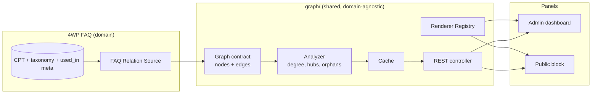

# Graph layer — architecture

Status: **Stages 0–3 done 2026-10-15 · Stage 4 next** · Layer 1.1.1 · Target: 4WP FAQ 2.7.0 · Owner: 4wpdev

Graph relations for 4WP plugins: show how domain records connect (hubs, clusters, orphans, dead categories) in admin, customer and public panels.

This document fixes the architecture before any code. Each stage below ends with an approval gate.

---

## 1. Principles

1. **Graph is a view, not a store.** The source of truth stays in the domain (FAQ: CPT, taxonomy, `used_in_posts`). The graph is derived on request and cached.
2. **Cross-cutting concern, embedded per plugin.** Same model as `ai/`: a reusable, encapsulated layer shipped inside every plugin that needs it. A plugin installed alone must work alone. No hard dependency on 4wp-bundle or another plugin.
3. **Domain-agnostic core.** The layer knows only a neutral contract (nodes + edges), styling input and display criteria. It never knows what a "FAQ", "task" or "document" is.
4. **Multi-provider.** Same pattern as 4WP Weather (`Provider_Registry`) and 4WP Drive (`Source_Registry`): interface + registry + `apply_filters` + placeholder providers for planned ones.
5. **SEO and accessibility by default.** Public output always has a server-rendered, crawlable fallback; the interactive canvas is progressive enhancement.

---

## 2. Three layers



| Layer | Lives in | Knows domain? | Responsibility |
|---|---|---|---|
| 1. Contract | `graph/` | No | Neutral data shape: node, edge, graph, meta |
| 2. Relation source (adapter) | plugin (`includes/class-graph-relations.php`) | Yes | Map domain data → contract |
| 3. Renderer | `graph/` + JS | No | Draw contract with chosen library |

Rule: **the adapter never talks to the renderer.** Only through the contract. Renderer changes without touching plugins; a plugin is added without touching the renderer.

---

## 3. Naming

Recommended: **`graph`** — folder `graph/`, namespace `ForWP\Graph`, constants `FORWP_GRAPH_LAYER_*`. Short, mirrors `ai/`, describes the cross-cutting part (rendering + analysis).

Alternatives considered:

| Name | Verdict |
|---|---|
| `graph` | ✅ Recommended. Neutral, short, matches `ai/`. |
| `relations` | Describes the domain side (adapter), not the shared layer. Better used for the per-plugin source class. |
| `relgraph` / `relation-graph` | Precise but long; no gain over `graph`. |
| `map` | Collides with 4WP Map. |

---

## 4. Folder layout (in 4WP FAQ)

Rule: **`graph/` holds methods, libraries, providers and UI only.** Node types, edge types, taxonomies and entities live in the plugin.

```
graph/                                   # shared layer — identical copy in every plugin
├── load.php                             # registers this copy; newest version boots once
├── bootstrap.php                        # files of the winning copy
├── class-contract.php                   # nodes + edges shape, validation, limits
├── class-analyzer.php                   # degree, hubs, orphans, weak groups, clusters
├── class-cache.php                      # transient cache, version-key invalidation
├── class-rest.php                       # GET {plugin-ns}/graph for each source
├── class-source-registry.php            # filter: forwp_graph_sources
├── class-renderer-registry.php          # filter: forwp_graph_renderers, forwp_graph_renderer
├── contracts/
│   ├── interface-relation-source.php
│   └── interface-renderer.php
├── renderers/
│   ├── class-cytoscape-renderer.php     # default; implemented when vendor file ships
│   └── class-placeholder-renderer.php   # sigma, d3, mermaid (planned)
├── class-admin-view.php                 # enqueue + mount point; texts come from the plugin
└── assets/
    ├── graph-view.js                    # vanilla JS, no build: tiles, slices, graph, side panel, bar charts
    ├── graph-view.css
    └── vendor/cytoscape.min.js          # 3.34.3, MIT, bundled (no CDN)

includes/                                # FAQ domain
├── class-admin-graph.php                # menu page 4WP FAQ → Graph (after Dashboard) + UI texts
├── graph-relations.php                  # hooks the source + renderer setting into the layer
└── class-graph-relations.php            # nodes: entry, category, content; edges: in_category, child_of, used_in
```

Work page: **4WP FAQ → Graph** (menu, right after Dashboard). Settings → Graph keeps only the switch (on by default), renderer and an Open Graph button. Options `forwp_faq_graph_enabled`, `forwp_faq_graph_renderer`.

## 5. Contract (layer 1)

JSON returned by every source, identical across FAQ, SEO Helper, Drive, TODO, Analytics Dashboard.

```json
{
  "version": 1,
  "source": "faq",
  "generated_at": "2026-10-15T13:00:00Z",
  "nodes": [
    { "id": "faq:123", "type": "entry",    "label": "How do I install?", "url": "…", "weight": 4, "meta": {} },
    { "id": "term:7",  "type": "category", "label": "Bundle",            "url": "…", "weight": 0, "meta": {} },
    { "id": "post:55", "type": "page",     "label": "Getting started",   "url": "…", "weight": 0, "meta": {} }
  ],
  "edges": [
    { "id": "e1", "source": "faq:123", "target": "term:7",  "type": "in_category", "weight": 1 },
    { "id": "e2", "source": "faq:123", "target": "post:55", "type": "used_in",     "weight": 1 }
  ],
  "types": {
    "nodes": { "entry": { "label": "FAQ" }, "category": { "label": "Category" }, "page": { "label": "Page" } },
    "edges": { "in_category": { "label": "In category" }, "child_of": { "label": "Subcategory" }, "used_in": { "label": "Used in" } }
  },
  "stats": { "nodes": 3, "edges": 2, "hubs": [], "orphans": [], "dead_types": [] }
}
```

Rules:
- `id` is namespaced (`faq:`, `term:`, `post:`) — unique across sources, mergeable later.
- `type` values and labels are declared by the source in `types`; the layer never hardcodes them.
- `meta` is free-form, ignored by the layer, passed to tooltips.
- `stats` is filled by the Analyzer, not by the source.
- `types.nodes.*.role` — `group` (classifier: category, tag, project), `item` (record), `context` (where items are used). The Analyzer works on roles, never on domain names.
- `types.*.color` — optional styling input.
- Edges between two `group` nodes point **child → parent**. The Analyzer uses this to keep parent groups out of "weak".
- PHP 7.4 compatible (plugin minimum): plain classes + arrays, no enums/readonly.

---

## 6. Relation source (layer 2) — multi-provider

```php
namespace ForWP\Graph\Contracts;

interface Relation_Source_Interface {
    public function get_slug(): string;          // 'faq'
    public function get_label(): string;
    public function is_ready(): bool;            // FAQ: registry enabled
    public function get_rest_namespace(): string; // 'forwp-faq/v1'
    public function get_capability(): string;    // who may read it in admin
    public function build( array $args ): array; // returns contract (nodes, edges, types)
    public function get_cache_version(): string; // changes when domain data changes
}
```

Registry: `Source_Registry::all()` → `apply_filters( 'forwp_graph_sources', $map )`. Same shape as Weather/Drive.

### FAQ source — edges it emits

| Edge type | From → To | Data in FAQ today |
|---|---|---|
| `in_category` | entry → category | taxonomy terms (+ `_forwp_faq_primary_term`) |
| `child_of` | category → parent category | hierarchical taxonomy |
| `used_in` | entry → page/post | `used_in_posts` meta |
| `related` *(later)* | entry → entry | shared category / co-usage, computed |

Args: `category`, `post_type`, `lang` (Polylang), `include_pages` (bool), `limit`.

Cache version: `forwp_faq_last_scan_at` + term/post `last_changed` — invalidates on Rescan and on edits.

---

## 7. Analyzer

Server-side, domain-agnostic, runs on the contract:
- **degree** per node;
- **hubs** — top-N by degree (heavily reused entries);
- **orphans** — degree 0 (unused, uncategorized);
- **dead categories** — category nodes with ≤ 1 entry;
- **components** — disconnected clusters.

Server-side so admin stats work without JS and the same numbers can feed the dashboard widgets and MCP abilities later.

---

## 8. Renderer (layer 3) — multi-provider

```php
interface Renderer_Interface {
    public function get_slug(): string;          // 'cytoscape'
    public function get_label(): string;
    public function is_implemented(): bool;
    public function enqueue(): void;             // registers vendor + adapter script
    public function get_js_handle(): string;
}
```

| Renderer | Status | When |
|---|---|---|
| Cytoscape.js | ✅ Default | Relations, built-in graph algorithms, layouts (cose/fcose, concentric, breadthfirst). MIT. |
| Sigma.js + graphology | Planned | Thousands of nodes, WebGL. |
| D3 (force) | Planned | Custom visuals only. |
| Mermaid | Planned | Static export to MD/GitHub/4WP Advanced Code; reuses existing flowchart practice. |

JS boundary: `graph-view.js` fetches the contract from REST and calls `window.forwpGraph.renderers[slug].mount(el, contract, options)`. Each renderer maps the contract to its own format (Cytoscape `elements`). Options = styling input (colors per node type, sizes by weight) + display criteria (filters, collapsed types, layout).

---

## 9. Shared-layer loading and versions

`ai/` uses `if ( ! defined( 'FORWP_AI_LAYER_LOADED' ) )` — first plugin to load wins. With FAQ, SEO Helper, Drive and TODO all shipping `graph/`, an older copy could win.

**Decision: version-aware loader — only the newest copy loads, exactly once.** Every plugin's `graph/load.php` registers its copy (version, dir, url) as a candidate. One boot (on `plugins_loaded`, or immediately if that already fired) picks the highest version, requires it and fires `forwp_graph_layer_loaded`. Domain sources always load from their own plugin, on that action. The boot function is a frozen contract (v1): later copies may add files, never change how candidates are picked. Same fix can later be applied to `ai/`.

---

## 10. Surfaces

| Surface | Stage | Output |
|---|---|---|
| Admin page 4WP FAQ → Graph | 3 ✅ | Tiles, slices (Everything / Categories & questions / Questions & pages / Issues), category filter, layouts, search, side panel, coverage bar, questions-per-category and top-pages bar charts |
| REST `GET forwp-faq/v1/graph` | 2 | Contract JSON; `edit_posts` in admin context, public context only with published data |
| Public block `forwp/faq-graph` | Deferred | Not in this release. FAQ relations are internal editorial data; revisit after admin slices prove useful. |
| WP-CLI / MCP ability | later | `wp forwp-faq graph --format=json`, ability for 4WP MCP connector |

SEO default: the public block outputs crawlable internal links (category → entry → page) as HTML first; canvas hydrates over it. No graph-only content.

---

## 11. Stages (each ends with approval)

| # | Stage | Deliverable |
|---|---|---|
| 0 | Architecture | This document ← **you are here** |
| 1 | Shared layer skeleton | `graph/` loader, contract, interfaces, registries, cache, REST controller. No UI. Unit tests for contract. |
| 2 | FAQ source + Analyzer | `class-faq-relations.php`, `GET forwp-faq/v1/graph`, stats. Verified on 4wp.dev data (≈296 entries / 9 categories). |
| 3 | Cytoscape renderer + admin page | ✅ Bundled vendor, `graph-view.js`, menu page 4WP FAQ → Graph. |
| 4 | Admin slices | Filters and views found useful in Stage 3 (by category, by page, orphans only, hubs only). Public block deferred. |
| 5 | Hardening + release | Tests, perf check on large registry, docs, readme, 2.7.0. Then port layer to SEO Helper. |

---

## 12. Decisions (2026-10-15)

1. Name: `graph` ✅
2. Cytoscape.js default, bundled locally, no CDN (WordPress.org requirement) ✅
3. Loader: newest copy only, loaded once ✅
4. Admin first; public output deferred ✅
5. Git: read-only for the assistant. No commits, no pushes, ever. ✅

## 13. Known issues to watch

- **Text domain in shared layers.** WordPress.org Plugin Check expects the plugin slug as text domain. `ai/` uses `4wp-ai`. `graph/` keeps translatable strings out of the layer (labels come from the domain source, which uses the plugin's own domain).

## 14. Stage 2 result on 4wp.dev local data (2026-10-15)

| Metric | Value |
|---|---|
| Nodes | 424 (358 questions, 25 categories, 41 pages) |
| Links | 594 (296 in_category, 282 used_in, 16 child_of) |
| Orphans | 0 |
| Weak categories | 0 (Plugins, WP-CLI, General hold 0 questions but are parent categories — not weak) |
| Clusters | 21, largest 97 nodes |

Observations worth a slice in Stage 4:
- 86 questions have no category (held in the graph only by "Used in").
- 78 questions are not used on any page (held only by their category).
- 0 questions have neither — hence 0 orphans.
- Top page hub: the 4WP FAQ plugin page (19 links).
